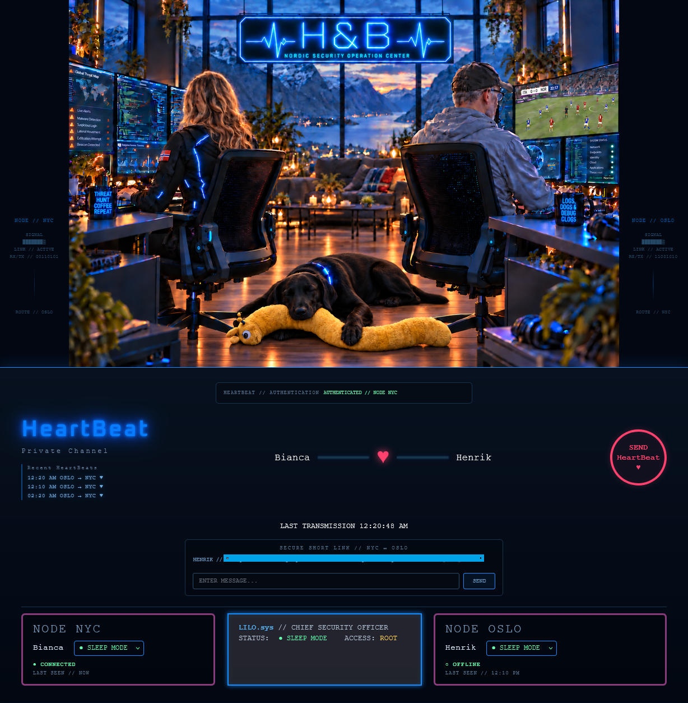
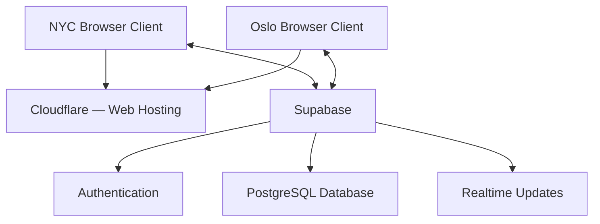

# HeartBeat — Real-Time Web Application

## Project Overview

**HeartBeat** is a personal web application I developed to enable real-time communication between two geographically separated users.

The application uses a two-node architecture (New York and Oslo), allowing users to exchange heartbeats, send messages, share availability statuses, and receive visual feedback through a custom interface.

Built using HTML, CSS, JavaScript, and Supabase, HeartBeat explores real-time database communication, frontend development, and cloud-based application architecture.

The project combines practical web development with a personal use case, focusing on simplicity, responsiveness, and reliable communication.

**This repository documents the project's design, architecture, functionality, and development process. The application source code is maintained in a separate private repository.**
## Application Interface

HeartBeat features a custom-designed interface with real-time messaging, heartbeat transmission, authentication, and individual node status panels.

## Technologies

| Component | Technology |
|---|---|
| Frontend | HTML, CSS, JavaScript |
| Database | Supabase PostgreSQL |
| Real-time communication | Supabase Realtime |
| Version control | Git and GitHub |
| Architecture | Two-node web application |
| Authentication | Supabase Auth |
| Hosting and deployment | Cloudflare |

## Implemented Features

### Real-Time Communication
- Send and receive heartbeats between New York and Oslo nodes
- Exchange direct messages between users
- Share and update individual availability statuses
- Synchronize information between connected browser sessions

### User Interface
- Custom-designed interface with a cybersecurity-inspired theme
- Animated heartbeat transmission and reception
- Visual indicators for user and node statuses
- Dedicated status controls for Lilo
- Recent heartbeat history

### Backend and Data
- PostgreSQL database hosted on Supabase
- Real-time subscriptions for cross-node updates
- Persistent heartbeat and status information
- Browser-based node identification

 
## Security and Authentication

HeartBeat integrates **Supabase Authentication** to manage user access and maintain authenticated sessions.

**Implemented features:**
- Email-and-password authentication through Supabase Auth
- Login integrated into the web application
- Persistent authentication sessions, allowing users to remain signed in
- Supabase Row Level Security (RLS) enabled on application database tables
- Authentication and database management handled through Supabase

**Security architecture:**

Supabase Auth manages user authentication and sessions, while PostgreSQL Row Level Security provides database-level access controls.

The application is designed for a small, private group of authorized users rather than public registration.

## Project Architecture

HeartBeat uses a two-node design, with both browser clients communicating through Supabase.

The database stores application information, while Supabase Realtime distributes updates between connected clients.

This enables communication without requiring users to refresh the page manually.

Conceptual architecture showing the application's hosting and backend services.

  

## Deployment

HeartBeat is deployed online using **Cloudflare**, making the application accessible to its authorized users from different locations.

The frontend communicates with Supabase for authentication, persistent data storage, and real-time updates.

This architecture allows both users to access the same application independently while exchanging messages, heartbeats, and status information in real time.
